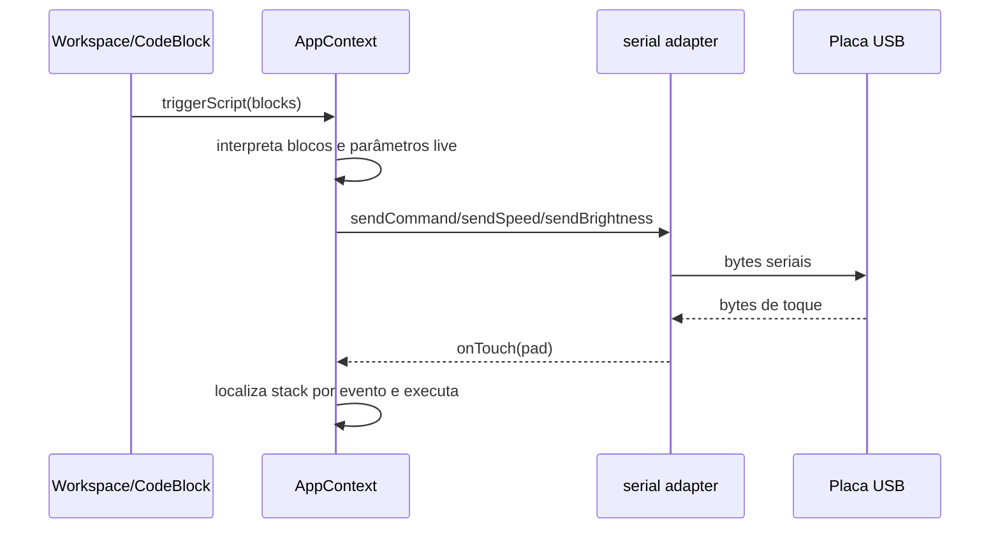

# Fluxos de dados

## Programa visual até placa/som

1. `BLOCKS` e `BLOCK_TEMPLATES` fornecem opções e valores iniciais.
2. `CategoryBand` adiciona um `WorkspaceBlock` a um `BlockStack`; `Workspace` aninha blocos em `innerBlocks`/`elseBlocks` e atualiza posição/ordem.
3. `CodeBlock` exibe os parâmetros. Inputs/dropdowns escrevem strings em `liveParamValues` com chave `${blockId}_${paramIdx}`.
4. Toque em bloco chama `tapBlock`; botão executar chama `triggerScript`; entrada serial de toque chama `simulateTouch` internamente via listener e encontra a stack por evento/valor.
5. `executeScript` lê `defId`, `label` e parâmetros live; chama `executeBlock`, que delega som para `playSound`/`PipasAudio` ou envia comandos a `board`.

O protocolo/hardware indicado pelo código não foi validado com firmware presente.

## Persistência das stacks

`AppContext` serializa `BlockStack[]` em JSON sob `pipas_stacks_v1`, usando `localStorage` na web ou AsyncStorage nativo; na montagem, tenta ler e parsear o valor. Posição, IDs e estrutura aninhada fazem parte do JSON persistido.

## Sons de usuário

- Web: gravação gera Blob/URL; `soundStorage` converte para Base64 e armazena metadados/áudio juntos em localStorage (`pipas_user_sounds_v1`); ao carregar, reconstrói Blob URL.
- Android: módulo de gravação cria arquivo `.m4a` em cache; `soundStorage.saveSound` copia para Documents com extensão `.webm` e guarda metadados/path em AsyncStorage. `loadSounds` verifica se o arquivo ainda existe.
- A função Android do catálogo de sons acessa assets em `sounds/<fileKey>.wav`.

**Problema observado:** há divergência entre extensão/conteúdo no fluxo Android: o gravador nativo produz MP4/AAC `.m4a`, enquanto storage dá nome `.webm`; a renderização de efeitos também escreve M4A. Documentado sem corrigir.

## Estados locais

`AppContext` também mantém em memória estado de execução, conexão, aba ativa, drawer, arrasto, warning, volume, brilho/velocidade de LEDs. Parte disso não é persistida (p.ex. conexão e programa em execução).
