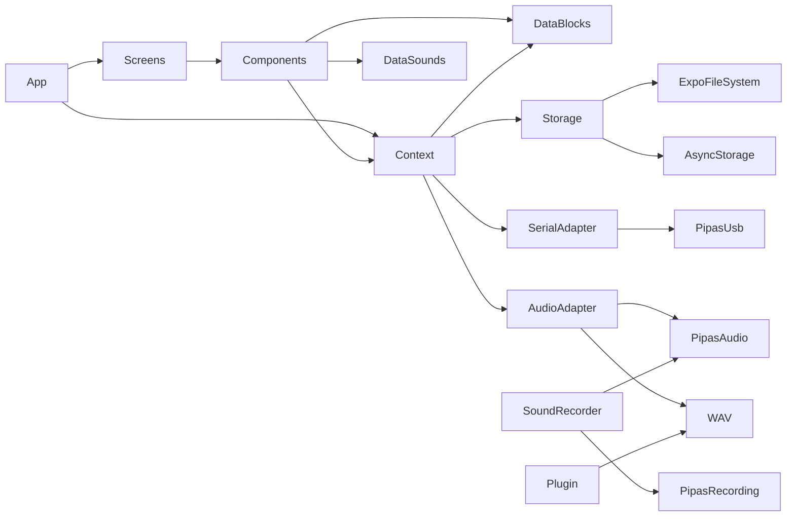

# Mapa de dependências

| Grupo | Elementos | Observação |
| --- | --- | --- |
| Runtime/UI | React 19.2.3, React Native 0.85.3, React Native Web 0.21.2, Expo ~56 | Fonte em `package.json`; versões resolvidas no lockfile |
| Gestos/UX nativa | gesture-handler, reanimated, worklets, safe-area-context, screens | Usados em componentes/raiz; babel plugin Reanimated em `babel.config.js` |
| Navegação | Nenhuma biblioteca de navegação instalada | Abas controladas com `activeTab`; nome do produto não implica React Navigation |
| Persistência | AsyncStorage, expo-file-system, browser localStorage | Dados locais; sem DB relacional/remoto |
| Expo | expo-dev-client, expo-modules-core, expo-file-system, status-bar, plugins | Development build necessário para módulos nativos próprios |
| USB Android | `usb-serial-for-android` declarada nos Gradle dos módulos | Protocolo e dispositivos suportados dependem da lib/firmware |
| Build/distribuição | Expo CLI/EAS profiles, Vercel config web | Sem workflow CI versionado identificado |

## Não encontrados

Banco de dados, migrations, API client de negócio, SDK de analytics/crash reports, autenticação, fila/cache e testes/framework de testes. Ver [`audit.md`](../audit.md) para limitações do inventário.
