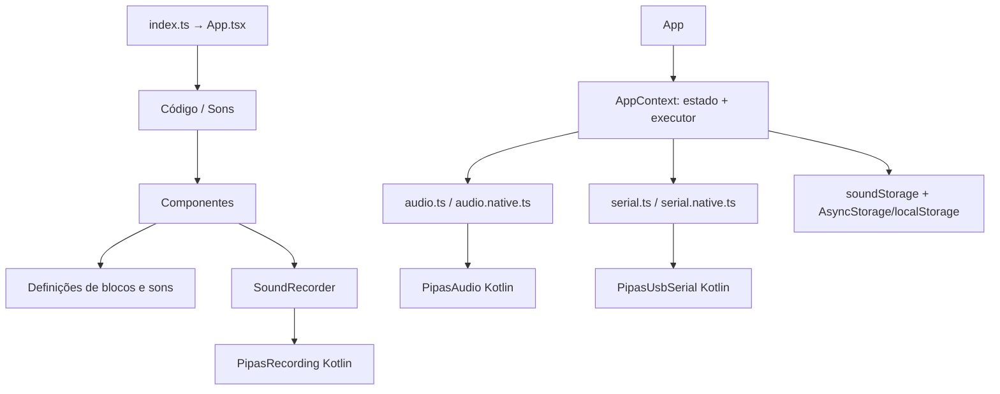

# Visão arquitetural

## Resumo

**Fatos:** o app é Expo SDK 56 + React Native 0.85 + React 19, TypeScript strict; tem `App.tsx` como raiz React, sem Expo Router. A UI chama telas/componentes; `AppProvider` concentra estado, persistência e interpretação sequencial de blocos; adaptadores `.native.ts` ou `.ts` fornecem implementação por plataforma; módulos Kotlin integram recursos Android.

Estilo efetivo: **aplicação cliente modular por funcionalidade, com contexto global e adaptadores de plataforma**. Não há camadas formais de domínio/repositório/serviço separadas em todo o código. O interpretador e estado global estão juntos em `src/context/AppContext.tsx`; alguns componentes concentram UI e lógica não trivial.

O diagrama representa imports/uso observados. O encadeamento interno da placa física e o firmware não estão neste repositório.

## Plataformas

- **Web:** React Native Web; reprodução pelo `window.Audio`, gravação via APIs web (`getUserMedia`, `MediaRecorder`, Web Audio) e serial via Web Serial API.
- **Android:** desenvolvimento Expo com development client; áudio, gravação e USB usam módulos Expo locais Kotlin.
- **iOS:** scripts/config Expo existem, mas os três módulos locais declaram apenas Android. A funcionalidade nativa equivalente em iOS não está implementada neste checkout.

Veja [`system-design.md`](system-design.md), [`layers-and-boundaries.md`](layers-and-boundaries.md) e [`dependency-map.md`](dependency-map.md).
